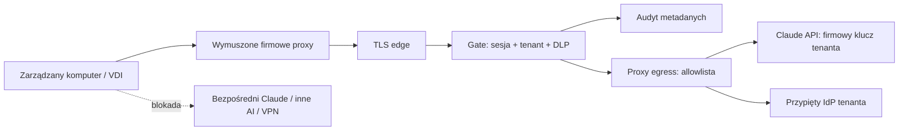

# Architektura i model zagrożeń

Cel: zatwierdzone konta organizacyjne, jeden kanał AI, odrzucanie wykrytych danych wrażliwych przed egress, bez logowania treści. Multi-tenant oznacza rejestr wielu firm, z niezależnymi granicami tożsamości i politykami.

## Granice zaufania

1. Komputer, użytkownik, przeglądarka i wszystkie dane żądania są niezaufane. Same kontrolki interfejsu nie stanowią zabezpieczenia.
2. Operator konfiguruje tenant ID, issuer, client ID, claimy, role, model, UUID organizacji Claude i referencje sekretów. Rejestr jest montowany tylko do odczytu. Bootstrap udostępnia nazwy/slug firm; nie zawiera kluczy ani konfiguracji IdP. Jeśli nazwy firm są poufne, potrzebny jest osobny host per tenant i ukryty katalog organizacji.
3. Wybór firmy na ekranie logowania ustala wyłącznie przypiętego IdP. Biblioteka OIDC weryfikuje issuer, audience, ważność, nonce i podpis. Gate dodatkowo sprawdza claim firmy i rolę. Wybranie BETA z kontem ACME nie daje sesji BETA. PKCE/state oraz cookie flow wiążą callback z inicjującą przeglądarką.
4. Dostęp do API wymaga sesji; cookie zawiera wyłącznie losowy identyfikator. Tenant i uprawnienia są po stronie serwera. `X-Tenant-ID`, e-mail, `Authorization`, query string i pola JSON nie zmieniają tożsamości.
5. Serwer waliduje schemat i całą historię. DLP nie korzysta z zewnętrznego modelu do klasyfikacji. Po detekcji żadne wywołanie dostawcy nie następuje. W API nie istnieją ścieżki do uploadu, narzędzi, dowolnego endpointu, modelu ani klucza.
6. Po zapisaniu `FORWARD_AUTHORIZED` serwer używa klucza firmowego przypisanego do sesji. Wstrzykuje `anthropic-allowed-org-ids` z konfiguracji danej firmy. Błędny UUID lub klucz ma powodować odmowę dostawcy; trzeba to potwierdzić testem live.
7. Odpowiedź jest filtrowana i wyświetlana jako tekst. Filtr odpowiedzi ogranicza ekspozycję do użytkownika; nie może cofnąć danych już przetworzonych przez dostawcę.

## Dwa niezależne wymagania

**Kontrola kont**: zatwierdzony issuer/tenant i rola + firmowy klucz z organizacji Claude; brak dostępu bez sesji. Tenant Restrictions potrafią dodatkowo ograniczyć konta na poziomie dostawcy, lecz nie analizują treści i nie wymuszają przejścia przez Gate.

**Kontrola przepływu**: komputery nie mogą bezpośrednio korzystać z Claude ani innych modeli/pośredników. W wybranym przez użytkownika trybie „cała praca przez bramę” nie dopuszczamy osobnych aplikacji Claude Desktop/Code ani bezpośredniej strony Claude. Samo dodanie nagłówka organizacji do Claude Web pozostawiłoby kanał omijający DLP tej bramy.

## Zagrożenia i zabezpieczenia

| Próba | Kontrola | Granica |
| --- | --- | --- |
| Prywatny login | Przypięty IdP, claim tenanta i rola | IdP musi ograniczać tożsamości osobiste/niezatwierdzonych gości |
| Podmiana tenanta | Tenant tylko z sesji serwera | Wspólny operator i proces pozostają zaufane |
| Własny klucz API/model/URL | Ścisły schemat, stały endpoint i konfiguracja serwera | Klucze serwera wymagają vaulta i rotacji |
| Wklejenie PESEL/sekretu | DLP przed egress, skan historii | Niepełne wykrywanie tajemnic opisowych/obfuskacji |
| Upload/obraz/MCP | Brak tych funkcji i odrzucanie pól | Nie uruchamiać równoległego proxy bez kontroli treści |
| CSRF/XSS/HTML modelu | Origin + token CSRF, CSP, textContent, brak zewnętrznych zasobów | Testy penetracyjne nadal wymagane |
| Utrata audytu | Zapis synchroniczny przed egress, zatrzymanie przy awarii | Zewnętrzny SIEM/checkpoint i retencja do wdrożenia |
| Uruchomienie innej aplikacji | App Control/MDM + sieciowe default deny | Sam Gate nie jest kontrolerem procesów Windows |
| Hotspot, VPN, QUIC, własny DNS | Always-on routing/VDI, firewall i MDM | Bez zarządzanego urządzenia brak gwarancji wymuszenia |
| Złośliwy admin/platforma | ACL, vault, separacja wdrożeń, monitoring | Pilot nie zapewnia fizycznej izolacji tenantów |

## Rzeczywista izolacja

Gate nie uruchamia modelu Claude lokalnie. Ścieżka zewnętrzna jest świadomym, ograniczonym wyjątkiem egress do firmowego API. Sieć kontenera Gate jest wewnętrzna, dostęp do Internetu zapewnia wyłącznie proxy z allowlistą hostname; end-to-end TLS pozostaje weryfikowany. Proxy jest dostępne tylko wewnątrz stacka. Reverse proxy nie udostępnia tunelowania ani forward proxy.

Pozostałe kontrolki wymagane u klienta: ochrona konfiguracji i vaulta, brak uprawnień lokalnego administratora, Secure Boot/BitLocker, podpisana polityka aplikacji, ochrona MDM przed usunięciem, firmowy DNS, egzekwowane reguły firewall i routing także poza biurem. Brama nie chroni przed fotografowaniem ekranu ani ręcznym przepisaniem danych na urządzeniu prywatnym.

## Rozwój przed skalowaniem

Wymagane: trwałe sesje i unieważnianie po zdarzeniach IdP, centralne limity i budżety kosztów per tenant, kolejka/przydział zasobów na firmę, zewnętrzny SIEM z retencją, vault z rotacją kluczy, semantyczny DLP/etykiety klasyfikacji i proces akceptacji danych, przegląd bezpieczeństwa oraz testy penetracyjne. Dla wysokiego poziomu izolacji: osobny deployment, klucze szyfrowania, baza i egress per tenant. Te elementy nie są deklarowane jako już wdrożone.
